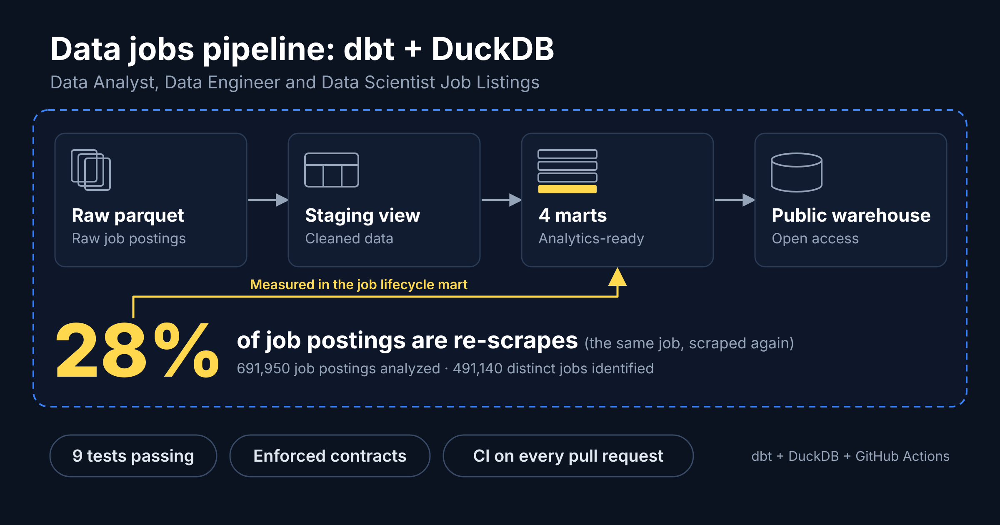
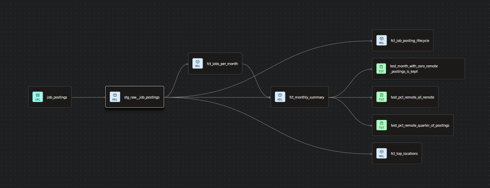
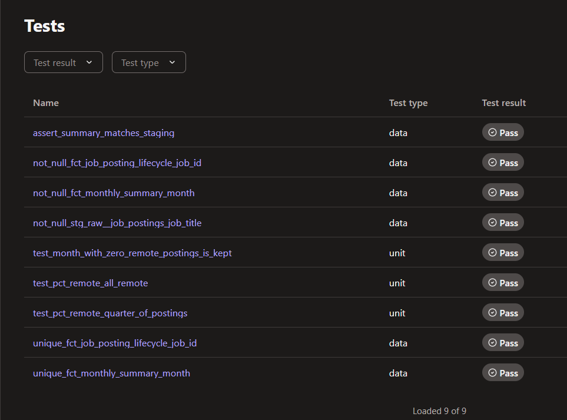
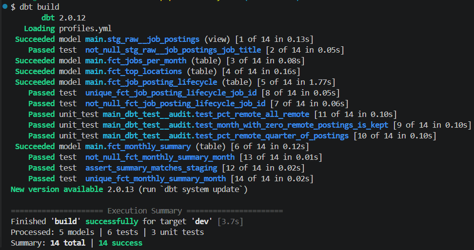

# 28% of These Job Postings Are Re-Scrapes: a dbt + DuckDB Pipeline

[](https://github.com/sneha-ae/dbt-duckdb-pipeline/actions/workflows/dbt_build.yml)

Roughly 28% of the rows in this dataset are the same job scraped again. Counting rows would overstate how many jobs exist, so I built a pipeline that measures it.

- Models ~692k real data job postings (Jul 2025 to Jun 2026) into staging and mart tables
- Guards the output with **enforced contracts**, **unit tests** and a **reconciliation test**
- Rebuilds on GitHub Actions and publishes the finished warehouse, so anyone can query it without cloning

Built from Luke Barousse's *dbt for Data Analytics & Engineering* course (Project 1), then extended on my own. The additions are listed below.





---

## 🔎 Key finding

| Metric | Value |
|---|---|
| Rows in staging | 691,950 |
| Rows with a `job_id` | 685,695 |
| Distinct jobs | 491,140 |
| Re-scraped rows (job already seen) | 194,555 (~28%) |
| Average scrapes per job | 1.4 |
| Longest a posting stayed live | 289 days |
| Scrape days covered | 362 (2025-07-01 to 2026-06-30) |

6,255 rows have no `job_id`, so they are left out of the lifecycle mart.

I made one new mart for this, `fct_job_posting_lifecycle`. It has one row per job, with `first_seen`, `last_seen`, `times_scraped`, `days_seen` and `days_live`. Every number above was checked against the built database. Data: job postings from [datanerd.tech](https://datanerd.tech).

---

## 🛠️ What I built

| What I built | How I did it | Where to look |
|---|---|---|
| Layered models | A `stg_` view and `fct_` tables | [`analytics/models/`](analytics/models) |
| Enforced contracts | Column names and types fixed on all 4 marts | [`_marts__models.yml`](analytics/models/marts/_marts__models.yml) |
| Unit tests | 3 tests on `fct_monthly_summary` | [`_marts__unit_tests.yml`](analytics/models/marts/_marts__unit_tests.yml) |
| Reconciliation test | Summary total must equal the staging row count | [`assert_summary_matches_staging.sql`](analytics/tests/assert_summary_matches_staging.sql) |
| Original mart | One row per job, with first and last seen | [`fct_job_posting_lifecycle.sql`](analytics/models/marts/fct_job_posting_lifecycle.sql) |
| CI | Builds on pull requests, publishes on `main` | [`dbt_build.yml`](.github/workflows/dbt_build.yml) |
| Published warehouse | One `ATTACH`, open to anyone | [Query it](#-query-the-published-warehouse) |

---

## 🧭 Lineage



The raw parquet source feeds one staging view. Four mart tables are built from it, and the three unit tests sit on `fct_monthly_summary`.

---

## ✅ Quality checks

9 tests pass on every build: 3 unit tests, 1 reconciliation test, and 5 not-null / unique checks. Contracts add one more guard, because a changed column name or type fails the build.



### A bug the unit tests caught

A unit test for a month with zero remote postings failed. The model used an inner `JOIN`, which silently dropped any month with no remote postings. The fix was a `LEFT JOIN` with `COALESCE`.

```diff
- SELECT month, total_postings, remote_postings,
-        ROUND(100.0 * remote_postings / total_postings, 1) AS pct_remote
+ SELECT month, total_postings, COALESCE(remote_postings, 0) AS remote_postings,
+        ROUND(100.0 * COALESCE(remote_postings, 0) / total_postings, 1) AS pct_remote
  FROM totals
- JOIN remote USING (month)
+ LEFT JOIN remote USING (month)
  ORDER BY month
```

---

## 🦆 Query the published warehouse

No clone needed. Install the [DuckDB CLI](https://duckdb.org/install), then:

```sql
INSTALL httpfs;
LOAD httpfs;
ATTACH 'https://github.com/sneha-ae/dbt-duckdb-pipeline/releases/download/warehouse/prod.duckdb' AS jobs (READ_ONLY);

-- Check the finding yourself: rows vs distinct jobs
SELECT count(*) AS rows_with_id, count(DISTINCT job_id) AS distinct_jobs
FROM jobs.main.stg_raw__job_postings
WHERE job_id IS NOT NULL;
```

Expected: 685,695 rows and 491,140 distinct jobs.

---

## 🧠 Decisions

- **Views for staging, tables for marts.** Staging only cleans and renames, so a view is enough. The marts are what people query, so I made them tables.
- **Contracts and unit tests.** Contracts protect the shape of each table. Unit tests protect the logic, which is how I found the dropped-months bug.
- **No source freshness check.** The dataset is a fixed archive, so a freshness check would warn forever. It also doesn't work with external parquet files.
- **A weekly CI run.** The data doesn't change, so the weekly run only confirms the pipeline still builds.
- **Left out on purpose.** A dashboard and a salary or skills analysis. I wanted one finished, trustworthy project rather than several half-done ones.

---

## 💻 Run it yourself

```bash
uv sync
uv run python scripts/download_data.py
cd analytics
uv run dbt build --profiles-dir ../ci
```

This is the same command CI runs. It should end with 14 total, 14 success (5 models, 6 tests, 3 unit tests).




---

## 📁 Project layout

```
.
├── .github/workflows/dbt_build.yml   # CI: build, test, publish
├── analytics/                        # the dbt project
│   ├── dbt_project.yml
│   ├── models/
│   │   ├── staging/                  # source + stg_raw__job_postings (view)
│   │   └── marts/                    # 4 fct_ tables, contracts, unit tests
│   └── tests/                        # reconciliation test
├── ci/profiles.yml                   # DuckDB target used by Actions
├── img/                              # README images
├── scripts/download_data.py          # fetches the raw parquet
├── pyproject.toml
└── uv.lock
```
